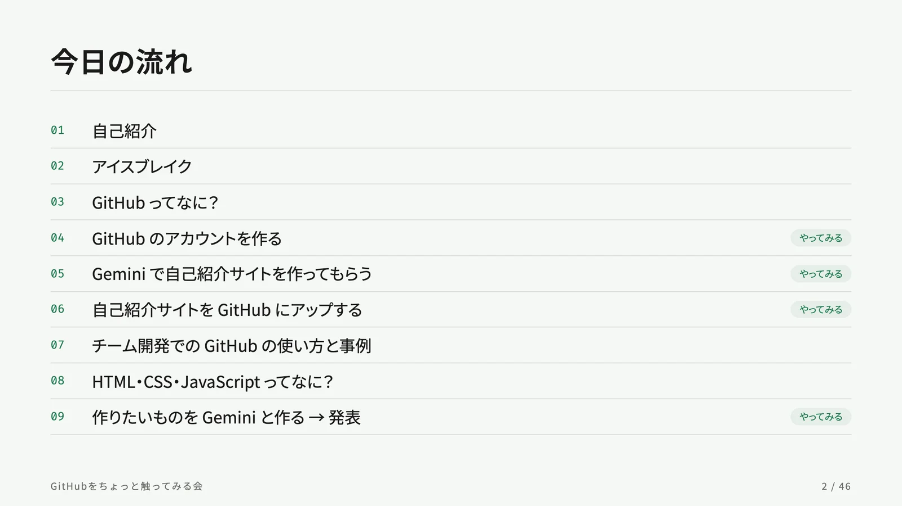
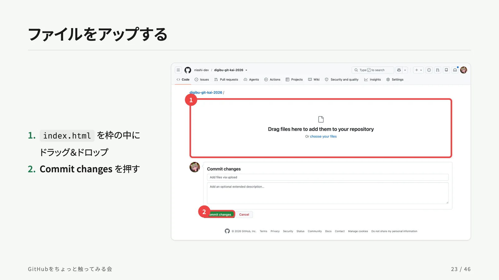
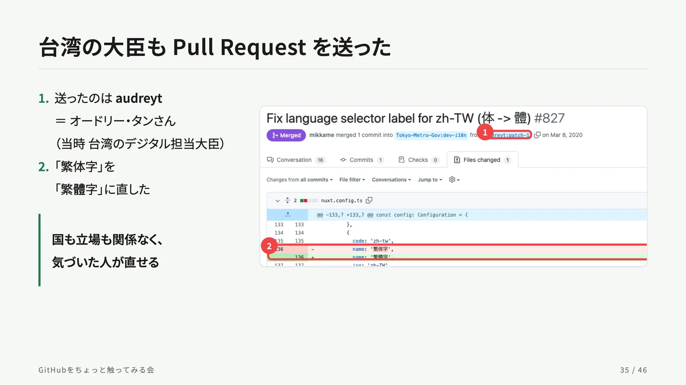
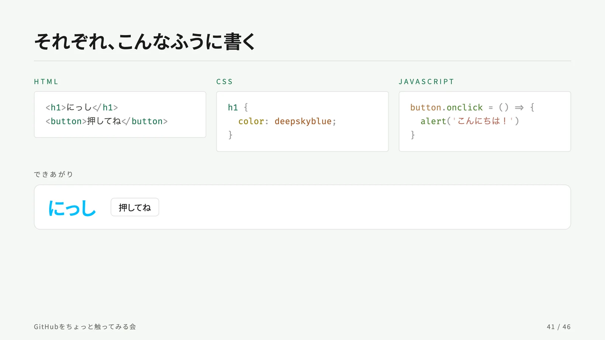

<div align="center">

<a href="https://nisshi-dev.github.io/digibu-git-kai-2026-slides/">
  
</a>

# GitHubをちょっと触ってみる会

**Gemini で作って、GitHub に置いて、Web に公開するまで**

デジ部 Git会 2026（2026.11.01）のスライド

[**スライドを見る**](https://nisshi-dev.github.io/digibu-git-kai-2026-slides/)
&nbsp;&nbsp;·&nbsp;&nbsp;
[slides.md](./slides.md)
&nbsp;&nbsp;·&nbsp;&nbsp;
[nisshi.dev](https://nisshi.dev)

[](https://github.com/nisshi-dev/digibu-git-kai-2026-slides/actions/workflows/deploy.yml)
[](https://sli.dev)

</div>

<br>

## この会について

GitHub を見たことがない人向けの、手を動かす勉強会です。
AI（Gemini）に自己紹介サイトを作ってもらい、それを GitHub に置いて、GitHub Pages で世界に公開するところまでを、みんなで一緒にやります。

コマンドは使いません。ブラウザだけで完結します。

## 内容

| | テーマ | スライド |
|:--:|---|:--:|
| 01 | 自己紹介 | 3 |
| 02 | アイスブレイク：AI、何使ってますか？ | 4–6 |
| 03 | GitHub ってなに？ | 7–9 |
| 04 | GitHub のアカウントを作る **（ハンズオン）** | 10–11 |
| 05 | Gemini で自己紹介サイトを作ってもらう **（ハンズオン）** | 12–17 |
| 06 | 自己紹介サイトを GitHub にアップする **（ハンズオン）** | 18–26 |
| 07 | チーム開発での GitHub の使い方（Issue・Pull Request） | 27–30 |
| | 事例：東京都の新型コロナ対策サイト | 31–38 |
| 08 | HTML・CSS・JavaScript ってなに？ | 39–42 |
| 09 | 作りたいものを Gemini と作る → 発表 **（ハンズオン）** | 43–46 |

<table>
  <tr>
    <td width="50%"></td>
    <td width="50%"></td>
  </tr>
  <tr>
    <td width="50%"></td>
    <td width="50%"></td>
  </tr>
</table>

## 手元で動かす

```bash
npm ci
npm run dev      # http://localhost:3030 で開く
```

| コマンド | やること |
|---|---|
| `npm run dev` | スライドを開く（編集するとすぐ反映される） |
| `npm run build` | 公開用のファイルを `dist/` に作る |
| `npm run export` | PDF に書き出す（初回は `playwright-chromium` のインストールが必要） |

発表するときは、`http://localhost:3030/presenter` を開くと発表者ノートが見られます。

## ファイル構成

```
.
├── slides.md                 スライド本体
├── styles.css                全体のデザイン（色・文字・カードなど）
├── global-top.vue            全スライド共通のフッター（タイトルとページ番号）
├── components/
│   └── Shot.vue              スクショに赤枠と番号を重ねる部品
├── public/
│   ├── github/               ハンズオンで使う GitHub の画面
│   └── case/                 事例（新型コロナ対策サイト）の画面
└── .github/workflows/
    └── deploy.yml            GitHub Pages への自動公開
```

## スクショに赤枠を付ける

ハンズオンのスライドでは、`<Shot>` 部品で「ここを押す」場所を赤枠と番号で示しています。
座標は元画像のピクセルで `[左, 上, 右, 下]` の順に書きます。

```vue
<Shot
  src="/github/02-upload.webp"
  :marks="[[122, 237, 1878, 638], [210, 988, 427, 1041]]"
/>
```

| 指定 | 意味 |
|---|---|
| `marks` | 赤枠の位置。2 つ以上あると、左上に番号が付く |
| `crop` | 画像のうち、この範囲だけを切り出して見せる（映したくない部分を隠すとき用） |
| `start` | 番号の開始値（スライドの手順番号と合わせるとき用） |
| `width` / `height` | 元画像の大きさ（既定は 2000 × 1189） |

## 公開

`main` に push すると、GitHub Actions がビルドして GitHub Pages に公開します。
初回だけ、リポジトリの **Settings → Pages → Source** を「GitHub Actions」にしておきます。

## 出典

- 事例で使っている東京都の新型コロナ対策サイトの画面は、[Internet Archive](https://web.archive.org/) に保存された 2020 年 4 月 1 日のものです。
- コードと Pull Request は [Tokyo-Metro-Gov/covid19](https://github.com/Tokyo-Metro-Gov/covid19)、山口県版は [Code-for-Yamaguchi/covid19-yamaguchi](https://github.com/Code-for-Yamaguchi/covid19-yamaguchi) のものです。

<br>

<div align="center">
<sub>Made with <a href="https://sli.dev">Slidev</a> by <a href="https://github.com/nisshi-dev">nisshi-dev</a>（にっし）</sub>
</div>
