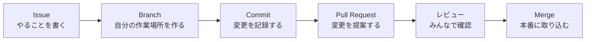

<div class="eyebrow pb-3 border-b border-[var(--rule)] w-[60%]">DIGIBU GIT-KAI 2026</div>

# GitHubを<br>ちょっと触ってみる会

<div class="muted text-lg">Gemini で作って、GitHub に置いて、Web に公開するまで</div>

<div class="absolute bottom-12 left-16 text-sm muted">2026.11.01　nisshi-dev（にっし）</div>

<!--
今日は「AIで作って、GitHubに置く」までを全員で体験します。
-->

---

# 今日の流れ

<div class="agenda">
  <div><span>01</span>自己紹介</div>
  <div><span>02</span>アイスブレイク</div>
  <div><span>03</span>GitHub ってなに？</div>
  <div><span>04</span>GitHub のアカウントを作る<em>やってみる</em></div>
  <div><span>05</span>Gemini で自己紹介サイトを作ってもらう<em>やってみる</em></div>
  <div><span>06</span>自己紹介サイトを GitHub にアップする<em>やってみる</em></div>
  <div><span>07</span>チーム開発での GitHub の使い方と事例</div>
  <div><span>08</span>HTML・CSS・JavaScript ってなに？</div>
  <div><span>09</span>作りたいものを Gemini と作る → 発表<em>やってみる</em></div>
</div>

<style>
.agenda > div {
  display: flex;
  align-items: center;
  gap: 1.2rem;
  padding: 0.36rem 0;
  border-bottom: 1px solid var(--rule);
}
.agenda span {
  font-family: var(--slidev-code-font-family, monospace);
  font-size: 0.8rem;
  color: var(--accent);
  width: 1.6rem;
}
.agenda em {
  font-style: normal;
  font-size: 0.65rem;
  color: var(--accent);
  background: var(--accent-soft);
  border-radius: 999px;
  padding: 0.1rem 0.6rem;
  margin-left: auto;
}
</style>

---
footer: false
---

<div class="w-[58%]">

<div class="eyebrow pb-2 mb-6 border-b border-[var(--rule)]">SPEAKER ・ SELF INTRODUCTION</div>

<div class="eyebrow">YOSHIKATSU NISHIDA</div>

<div class="flex items-end gap-3 mt-1">
  <span class="text-6xl font-bold leading-tight">nisshi-dev</span>
  <span class="text-sm muted pb-2">にっし</span>
</div>

<div class="text-xl font-bold mt-3 mb-6">VR技術が好きな、フロントエンドエンジニア</div>

<div class="kv text-sm">
  <div><span>本業</span><span>TypeScript や React を書く、フロントエンドエンジニア</span></div>
  <div><span class="!text-[var(--accent)]">コミュニティ</span><span>WebXR の技術コミュニティ「WebXR JP」を運営</span></div>
  <div><span>ものづくり</span><span>「リアルVRネームプレート」など、へんなものをつくる</span></div>
</div>

<div class="flex flex-wrap gap-x-5 gap-y-2 mt-6 text-xs font-mono">
  <span class="flex items-center gap-1"><ph-globe class="text-lg" />nisshi.dev</span>
  <span class="flex items-center gap-1"><ph-x-logo class="text-lg" />@nisshi_dev</span>
  <span class="flex items-center gap-1"><ph-github-logo class="text-lg" />nisshi-dev</span>
  <span class="flex items-center gap-1"><ph-virtual-reality class="text-lg" />nisshi-dev｜にっし</span>
</div>

</div>


<!--
本業・コミュニティ・ものづくりの3つを軽く紹介。
今日のテーマにつなげて「自分も GitHub に作ったものを置いている」と話す。
-->

---
layout: section
---

<div class="eyebrow">Icebreak</div>

# アイスブレイク

---

# AI、何使ってますか？

<div class="grid grid-cols-4 gap-4 mt-10 text-lg text-center">
  <div class="card">ChatGPT</div>
  <div class="card">Gemini</div>
  <div class="card">Claude</div>
  <div class="card">その他</div>
</div>

<div class="mt-10 muted">

どんなことに使ってる？

</div>

<!--
手を挙げてもらう。使い道（宿題、調べもの、画像生成など）も何人かに聞く。
-->

---

# GitHub、見たことありますか？

<div class="grid grid-cols-3 gap-4 mt-10 text-lg text-center">
  <div class="card">使ったことある</div>
  <div class="card">名前は聞いたことある</div>
  <div class="card">はじめて聞いた</div>
</div>

<!--
はじめての人が多くても大丈夫、と伝える。
-->

---
layout: section
---

<div class="eyebrow">About GitHub</div>

# GitHub ってなに？

---

# GitHub ってなに？

<div class="lead">作ったものを保存して、みんなと共有できる場所</div>

<div class="grid grid-cols-3 gap-4 mt-8">
  <div class="card">
    <ph-cloud-arrow-up class="text-2xl accent mb-2" />
    <div class="font-bold mb-1">保存する</div>
    <div class="text-sm muted leading-relaxed">コードやファイルをネット上に置いておける</div>
  </div>
  <div class="card">
    <ph-clock-counter-clockwise class="text-2xl accent mb-2" />
    <div class="font-bold mb-1">履歴が残る</div>
    <div class="text-sm muted leading-relaxed">いつ・誰が・何を変えたか全部記録される。ゲームのセーブポイントのよう</div>
  </div>
  <div class="card">
    <ph-users-three class="text-2xl accent mb-2" />
    <div class="font-bold mb-1">みんなで作る</div>
    <div class="text-sm muted leading-relaxed">世界中の人と同じプロジェクトを一緒に作れる</div>
  </div>
</div>

---

# GitHub は世界中で使われている

- 世界で 1 億人以上の開発者が使っている
- 有名なアプリやサービスの多くが GitHub 上で開発されている
- 誰でも見られる「公開プロジェクト」もたくさんある
- 作ったページを **そのまま Web に公開** することもできる（GitHub Pages）

<div class="point mt-10 text-lg">

プログラマーにとっての「作品置き場」兼「チームの作業場」

</div>

---
layout: section
---

<div class="eyebrow">Hands-on 01</div>

# GitHub のアカウントを作る

---

# GitHub のアカウントを作る

1. [github.com](https://github.com) を開く
2. 右上の **Sign up** を押す
3. メールアドレス・パスワード・ユーザー名を入力
4. メールに届いたコードを入力して認証
5. ログインできたら完了

<div class="note mt-8">

**注意**：ユーザー名はみんなに公開されます。本名でなくて OK です。

</div>

<!--
メール認証で止まりやすいので、まわりを見て回る。
-->

---
layout: section
---

<div class="eyebrow">Hands-on 02</div>

# Gemini で自己紹介サイトを作ってもらう

---

# テーマ：自分の自己紹介サイト

<div class="lead">インターネット上に「自分を紹介するページ」を作ってみよう</div>

<div class="grid grid-cols-2 gap-4 mt-6">
<div class="card">

### 書くこと

- ニックネーム
- 好きなもの・ハマっていること
- 得意なこと
- これからやってみたいこと

</div>
<div class="card !border-[var(--warn)] !bg-[var(--warn-soft)]">

### 書かないこと

- 本名（ニックネームで OK）
- 住所・学校名・電話番号
- 顔写真

<div class="text-sm muted mt-2">ページは世界中の誰でも見られるようになります</div>

</div>
</div>

<!--
最後の発表でもこのページを見せられる、と伝えておくとモチベが上がる。
-->

---

# 例：にっしの場合

<div class="grid grid-cols-[3fr_2fr] gap-8 items-center">
<div>

まずは書くことをメモしてみる

<div class="kv mt-4 text-sm">
  <div><span>ニックネーム</span><span>にっし</span></div>
  <div><span>好きなもの</span><span>VR、へんなものづくり</span></div>
  <div><span>得意なこと</span><span>Web サイトを作ること</span></div>
  <div><span>やってみたいこと</span><span>XR グラスで動くアプリを作る</span></div>
</div>

<div class="point mt-6">

みんなも 3 分くらいで書き出してみよう

</div>

</div>
<div class="flex justify-center">
  
</div>
</div>

---

# Gemini にお願いしてみる

1. [gemini.google.com](https://gemini.google.com) を開く
2. メモした内容を入れて、こんなふうにお願いする

```text
自己紹介サイトを作ってください。
- HTML 1 ファイルで完結させてください
- ニックネーム：にっし
- 好きなもの：VR、へんなものづくり
- 得意なこと：Web サイトを作ること
- やってみたいこと：XR グラスで動くアプリを作る
- 水色をベースにした、ポップなデザインにしてください
```

<!--
「HTML 1ファイルで」と伝えるのがコツ。CSS や JS が別ファイルに分かれると、アップが大変になる。
-->

---

# 保存して開いてみる

1. Gemini が出してくれたコードを **コピー**
2. メモ帳などに **貼り付け**
3. **`index.html`** という名前で保存
4. ファイルを **ダブルクリック** → ブラウザで開く

<div class="note mt-8">

**Mac のテキストエディットの場合**：メニューの「フォーマット」→「標準テキストにする」を先に選んでおこう

</div>

<div class="point mt-6">

自分の自己紹介ページが表示されたら成功

</div>

---

# もっと自分らしくしてみよう

できたページを見ながら、Gemini に **追加でお願い** してみる

<div class="grid grid-cols-2 gap-4 mt-6">
  <div class="card">「好きなものをカードで並べて」</div>
  <div class="card">「アイコンの代わりに絵文字を大きく入れて」</div>
  <div class="card">「ボタンを押すと背景の色が変わるようにして」</div>
  <div class="card">「スマホでも見やすくして」</div>
</div>

<div class="muted mt-6">

うまくいかなくても大丈夫。「さっきの方がよかった」と言えば戻せます

</div>

---
layout: section
---

<div class="eyebrow">Hands-on 03</div>

# 作った自己紹介サイトを<br>GitHub にアップする

---

# リポジトリを作る

<div class="grid grid-cols-[1fr_1.4fr] gap-8 items-center">
<div>

**リポジトリ** ＝ プロジェクトごとの<br>フォルダのようなもの

1. 右上の **＋** を押す
2. **New repository** を選ぶ

</div>

<Shot
  src="/github/00-new-repository.webp"
  alt="GitHub の右上の＋メニュー"
  :crop="[1180, 0, 2000, 500]"
  :marks="[[1615, 22, 1689, 70], [1425, 134, 1677, 179]]"
/>

</div>

---

# リポジトリを作る

<div class="grid grid-cols-[1fr_2.3fr] gap-6 items-center">
<div>

3. Repository name に<br>名前を入れる<br>（例：`my-profile`）
4. **Public** のままにする

</div>

<Shot
  src="/github/00a-new-repo-form.webp"
  alt="リポジトリの作成画面"
  :start="3"
  :marks="[[755, 352, 1510, 401], [1323, 724, 1485, 773]]"
/>

</div>

<!--
Public ＝ 誰でも見られる。GitHub Pages で公開するには Public が必要。
-->

---

# リポジトリを作る

<div class="grid grid-cols-[1fr_2.3fr] gap-6 items-center">
<div>

5. **Add README** は<br>**Off** のままにする
6. 一番下の<br>**Create repository** を押す

<div class="note text-sm mt-6">

README を On にすると、次の画面が変わってしまうので注意

</div>

</div>

<Shot
  src="/github/00b-new-repo-create.webp"
  alt="リポジトリ作成画面の下のほう"
  :width="2000"
  :height="1519"
  :crop="[300, 620, 1700, 1360]"
  :start="5"
  :marks="[[1413, 968, 1487, 1008], [1302, 1260, 1511, 1311]]"
/>

</div>

---

# ファイルをアップする

<div class="grid grid-cols-[1fr_2.3fr] gap-6 items-center">
<div>

作ったばかりのリポジトリは<br>こんな画面

**uploading an existing file** を<br>クリック

</div>

<Shot src="/github/01-empty-repo.webp" alt="作ったばかりの空のリポジトリの画面" :marks="[[425, 775, 642, 805]]" />

</div>

---

# ファイルをアップする

<div class="grid grid-cols-[1fr_2.3fr] gap-6 items-center">
<div>

1. `index.html` を枠の中に<br>ドラッグ＆ドロップ
2. **Commit changes** を押す

</div>

<Shot src="/github/02-upload.webp" alt="ファイルをアップロードする画面" :marks="[[122, 237, 1878, 638], [210, 988, 427, 1041]]" />

</div>

<!--
Commit ＝「この変更を記録します」という意味。メッセージは空のままでもOK。
-->

---

# アップできた

<div class="grid grid-cols-[1fr_2.3fr] gap-6 items-center">
<div>

`index.html` が一覧に<br>出ていたら成功

<div class="muted text-sm mt-2">

これで自己紹介サイトが GitHub に置けました

</div>

</div>

<Shot src="/github/03-uploaded.webp" alt="index.html がアップロードされたリポジトリの画面" :marks="[[122, 425, 1427, 485]]" />

</div>

---

# おまけ：Web に公開してみる

<div class="grid grid-cols-[1fr_2.3fr] gap-6 items-center">
<div>

**GitHub Pages** を使うと、<br>アップしたページを公開できる

1. **Settings** を開く
2. 左メニューの **Pages**
3. **None** を **main** に変えて<br>**Save** を押す

</div>

<Shot src="/github/04-pages-settings.webp" alt="GitHub Pages の設定画面" :marks="[[1430, 88, 1565, 132], [120, 886, 492, 937], [545, 586, 777, 639]]" />

</div>

---

# おまけ：Web に公開してみる

<div class="grid grid-cols-[1fr_2.3fr] gap-6 items-center">
<div>

「GitHub Pages source saved.」<br>と出たら OK

<div class="muted text-sm mt-2">

1〜2 分待つと、このページの上に URL が表示されます

</div>

```text
https://ユーザー名.github.io/
  リポジトリ名/
```

スマホからも見られます

</div>

<Shot src="/github/05-pages-saved.webp" alt="GitHub Pages の設定を保存した画面" :marks="[[549, 649, 872, 694]]" />

</div>

<!--
反映まで1〜2分かかることがある。URL が出ない場合はページを再読み込み。
-->

---
layout: section
---

<div class="eyebrow">About GitHub 2</div>

# チーム開発では<br>こう使う

---

# チーム開発の流れ



<div class="point mt-10 text-lg">

みんなが同時に作業しても、ぶつからずに進められる仕組み

</div>

---

# Issue：やることリスト

<div class="grid grid-cols-2 gap-8">
<div>

- 「やること」「直したいこと」を書いておく場所
- 誰が担当するかを決められる
- コメントで相談できる
- 終わったら **Close** する

</div>
<div class="card text-sm">

<div class="eyebrow mb-2">Issue #12</div>

**トップページにプロフィール画像を追加したい**

<div class="muted mt-1">担当：@tanaka</div>

<div class="mt-3 pt-3 border-t border-[var(--rule)]">

今は文字だけなので、画像があるといいと思います。
サイズはどのくらいがいいですか？

</div>

<div class="muted mt-2">コメント 3 件</div>

</div>
</div>

---

# Pull Request：「この変更を入れていい？」

<div class="grid grid-cols-2 gap-8">
<div>

- 自分の変更をチームに見てもらう
- 変わったところが一目でわかる
- 「ここ直したほうがいいかも」とコメントし合える
- OK が出たら **Merge**（取り込み）

</div>
<div class="card text-sm">

<div class="eyebrow mb-3">Pull Request #13</div>

<div class="font-mono text-xs rounded-md overflow-hidden border border-[var(--rule)]">
  <div class="px-3 py-1 bg-red-500/10 text-red-700">- &lt;h1&gt;ようこそ&lt;/h1&gt;</div>
  <div class="px-3 py-1 bg-green-500/10 text-green-800">+ &lt;h1&gt;ようこそ！&lt;/h1&gt;</div>
  <div class="px-3 py-1 bg-green-500/10 text-green-800">+ &lt;img src="profile.png"&gt;</div>
</div>

<div class="mt-3">

**@suzuki**：いいですね！画像の alt も付けましょう

</div>
</div>
</div>

<!--
いきなり本番を書き換えるのではなく、「確認してから取り込む」のがポイント。
-->

---
layout: section
---

<div class="eyebrow">Case Study</div>

# 事例：新型コロナ対策サイト

---

# 東京都の新型コロナ対策サイト

<div class="grid grid-cols-[1fr_2.3fr] gap-6 items-center">
<div>

2020 年 3 月、東京都が<br>感染状況をまとめた<br>サイトを公開した

<div class="muted text-sm mt-4">

画面は 2020 年 4 月 1 日の様子<br>（Internet Archive に保存されたもの）

</div>

</div>

<Shot src="/case/01-tokyo-site.webp" alt="東京都 新型コロナウイルス感染症対策サイト（2020年4月1日）" :width="1440" :height="900" />

</div>

---

# サイトのコードを GitHub で公開した

<div class="grid grid-cols-[1fr_2.3fr] gap-6 items-center">
<div>

誰でもコードを見たり、<br>コピーしたりできるようにした

<div class="kv text-sm mt-5">
  <div><span>Pull Request</span><span><b>6,000</b> 件以上</span></div>
  <div><span>Issue</span><span><b>1,700</b> 件以上</span></div>
  <div><span>参加した人</span><span>約 <b>380</b> 人</span></div>
</div>

</div>

<Shot
  src="/case/02-tokyo-repo.webp"
  alt="東京都のサイトの GitHub リポジトリ"
  :width="1440"
  :height="900"
  :crop="[0, 105, 1440, 900]"
  :marks="[[1105, 222, 1330, 256]]"
/>

</div>

<!--
件数は GitHub 上の総数（ボットによる自動更新も含む）。赤枠は Fork 1.9k / Star 6.2k。
-->

---

# 世界中から Pull Request が届いた

<div class="grid grid-cols-[1fr_2.3fr] gap-6 items-center">
<div>

公開直後の **2 日間**<br>（2020 年 3 月 5〜6 日）だけで<br>**106 件** の Pull Request が<br>取り込まれた

<div class="muted text-sm mt-4">

送ったのは、東京都の職員ではない<br>世界中のエンジニアたち

</div>

</div>

<Shot
  src="/case/03-tokyo-pulls.webp"
  alt="2020年3月5〜6日に作られた Pull Request の一覧"
  :width="1440"
  :height="900"
  :crop="[90, 225, 1350, 900]"
  :marks="[[205, 337, 305, 362]]"
/>

</div>

---

# 台湾の大臣も Pull Request を送った

<div class="grid grid-cols-[1fr_1.9fr] gap-6 items-center">
<div>

1. 送ったのは **audreyt**<br>＝ オードリー・タンさん<br>（当時 台湾のデジタル担当大臣）
2. 「繁体字」を<br>「繁**體**字」に直した

<div class="point mt-5">

国も立場も関係なく、<br>気づいた人が直せる

</div>

</div>

<Shot
  src="/case/04-audrey-pr.webp"
  alt="オードリー・タンさんの Pull Request #827"
  :width="1440"
  :height="900"
  :crop="[16, 222, 960, 615]"
  :marks="[[560, 280, 680, 303], [33, 560, 1408, 601]]"
/>

</div>

<!--
台湾で使う漢字（繁体字）では「体」ではなく「體」。言語切り替えメニューの表示を直した。
-->

---

# 全国に広がった

<div class="grid grid-cols-[1fr_1fr] gap-6 items-center">
<div>

東京都のサイトを **フォーク** して、<br>全国で地元版のサイトが作られた

<div class="card text-center mt-5">
  <div class="text-sm muted">東京都版がフォークされた数</div>
  <div class="text-3xl font-bold">約 1,900</div>
</div>

<div class="note text-sm mt-5">

**フォーク**：他の人のリポジトリを丸ごと自分のところにコピーして、自由に改造できる機能

</div>

</div>

<Shot
  src="/case/05-forked-sites.webp"
  alt="東京都のリポジトリにある、派生したサイトの一覧"
  :width="1087"
  :height="1000"
  :crop="[0, 0, 1087, 830]"
/>

</div>

<!--
右は東京都のリポジトリにある FORKED_SITES.md。都道府県ごとの派生サイトがずらっと並んでいる。
-->

---

# 山口県版も作られた

<div class="grid grid-cols-[1fr_2.3fr] gap-6 items-center">
<div>

東京都版をフォークして、<br>山口の有志が **複数人で** 開発

<div class="muted text-sm mt-3">

Issue や Pull Request で分担して作り、<br>のちに **山口県公認** のサイトになった

</div>

</div>

<Shot
  src="/case/06-yamaguchi-repo.webp"
  alt="山口県版のリポジトリ（Tokyo-Metro-Gov/covid19 からフォーク）"
  :width="1440"
  :height="900"
  :crop="[0, 105, 1030, 480]"
  :marks="[[106, 251, 334, 274]]"
/>

</div>

<!--
赤枠は「forked from Tokyo-Metro-Gov/covid19」。自分が関わったときの話をする（どう分担したか、どんな PR を出したか など）。
-->

---

# 3 年間、県民に使われた

<div class="grid grid-cols-[1fr_1.7fr] gap-6 items-center">
<div>

1. 2020 年 3 月 19 日に公開、<br>2023 年 3 月 31 日に終了
2. 「**東京都の OSS** を活用して<br>作成されました」

<div class="point mt-5">

公開されたコードが、<br>別の地域の役に立った

</div>

</div>

<Shot
  src="/case/07-yamaguchi-end.webp"
  alt="山口県公認 新型コロナウイルス感染症対策サイトの終了のお知らせ"
  :width="1440"
  :height="1000"
  :crop="[230, 580, 1210, 1000]"
  :marks="[[388, 760, 1052, 784], [372, 927, 1066, 953]]"
/>

</div>

<!--
OSS ＝ オープンソースソフトウェア。誰でも使える形でコードが公開されているソフトウェアのこと。
-->

---
layout: section
---

<div class="eyebrow">Web Basics</div>

# HTML・CSS・JavaScript<br>ってなに？

---

# Web ページは 3 つでできている

<div class="grid grid-cols-3 gap-4 mt-4">
  <div class="card">
    <div class="eyebrow accent mb-2">HTML</div>
    <div class="text-lg font-bold mb-1">骨組み</div>
    <div class="text-sm muted leading-relaxed">何を表示するか。見出し・文章・画像・ボタンなど</div>
  </div>
  <div class="card">
    <div class="eyebrow accent mb-2">CSS</div>
    <div class="text-lg font-bold mb-1">見た目</div>
    <div class="text-sm muted leading-relaxed">どう見せるか。色・大きさ・並べ方など</div>
  </div>
  <div class="card">
    <div class="eyebrow accent mb-2">JavaScript</div>
    <div class="text-lg font-bold mb-1">動き</div>
    <div class="text-sm muted leading-relaxed">どう動くか。ボタンを押したら〇〇する、など</div>
  </div>
</div>

<div class="point mt-8">

家にたとえると、HTML は柱や壁、CSS は壁紙や家具、JavaScript は電気のスイッチ

</div>

---

# それぞれ、こんなふうに書く

<div class="grid grid-cols-3 gap-4">
<div>

<div class="eyebrow accent mb-2">HTML</div>

```html
<h1>にっし</h1>
<button>押してね</button>
```

</div>
<div>

<div class="eyebrow accent mb-2">CSS</div>

```css
h1 {
  color: deepskyblue;
}
```

</div>
<div>

<div class="eyebrow accent mb-2">JavaScript</div>

```js
button.onclick = () => {
  alert('こんにちは！')
}
```

</div>
</div>

<div class="eyebrow mt-6 mb-2">できあがり</div>

<div class="card flex items-center gap-6">
  <span class="text-3xl font-bold" style="color: deepskyblue">にっし</span>
  <button class="border border-[var(--rule)] rounded-md px-3 py-1 bg-white text-sm" onclick="alert('こんにちは！')">押してね</button>
</div>

<!--
「できあがり」のボタンは実際に押せる。押して見せる。
-->

---

# Gemini が作った index.html の中身

<div class="grid grid-cols-[1.3fr_1fr] gap-8 items-center">
<div>

```html {2-6|7-9|10-12}
<html>
  <head>
    <style>
      /* ここが CSS */
    </style>
  </head>
  <body>
    <!-- ここが HTML -->
    <h1>にっし</h1>
    <script>
      // ここが JavaScript
    </script>
  </body>
</html>
```

</div>
<div>

「HTML 1 ファイルで」とお願いしたので、**3 つが 1 つのファイルに全部入っています**

<div class="note mt-6 text-sm">

わからないところは、Gemini に「この部分は何をしているの？」と聞いてみよう

</div>

</div>
</div>

<!--
クリックで CSS → HTML → JavaScript の順にハイライトされる。
-->

---
layout: section
---

<div class="eyebrow">Hands-on 04</div>

# 作りたいものを<br>Gemini と作ってみよう

---

# 作りたいものを Gemini と相談する

<div class="grid grid-cols-2 gap-8">
<div>

### アイデアの例

- 好きなものの紹介ページ
- クイズ・占いゲーム
- タイマーや計算ツール
- 部活やクラスの紹介ページ

</div>
<div>

### 相談の仕方

```text
〇〇を作りたいです。
どんな機能があると楽しいか
アイデアを 3 つ出してください。
```

```text
2 番目のアイデアを
HTML 1 ファイルで作ってください。
```

</div>
</div>

<div class="point mt-6">

できたら GitHub にアップして、GitHub Pages で公開まで

</div>

---

# 発表

<div class="grid grid-cols-3 gap-4 mt-8">
  <div class="card">
    <div class="eyebrow accent mb-2">01</div>
    <div class="text-lg font-bold">何を作った？</div>
  </div>
  <div class="card">
    <div class="eyebrow accent mb-2">02</div>
    <div class="text-lg font-bold">こだわったところは？</div>
  </div>
  <div class="card">
    <div class="eyebrow accent mb-2">03</div>
    <div class="text-lg font-bold">次にやってみたいことは？</div>
  </div>
</div>

<div class="muted mt-8">

GitHub Pages の URL を開いて、みんなに見せよう

</div>

<!--
1人1〜2分。GitHub Pages の URL を画面に映して見せてもらう。
-->

---

# まとめ

<div class="kv text-lg mt-4">
  <div><span>GitHub</span><span>作ったものを保存・共有して、みんなで作る場所</span></div>
  <div><span>AI</span><span>相談すれば、アイデアから形にできる</span></div>
  <div><span>チーム開発</span><span>Issue と Pull Request で進める</span></div>
</div>

<div class="lead mt-12">おつかれさまでした！</div>
